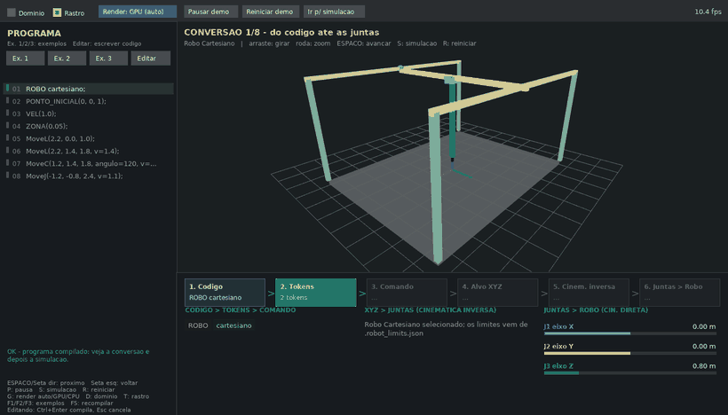

# RobotGL — do código à cinemática, até o robô se mexer

Simulador 3D de robôs **cartesiano** e **cilíndrico** em Python + OpenGL (`pyglet`), com uma
linguagem própria de comandos industriais (`MoveJ`, `MoveL`, `MoveC`) e um interpretador completo
(léxico → sintático → semântico).

> **Contexto acadêmico:** trabalho desenvolvido para a disciplina de **Robótica** da
> **Pontifícia Universidade Católica de Goiás (PUC Goiás)**, no **primeiro semestre de 2026**.

O diferencial do projeto: **antes de simular, ele mostra visualmente como o código vira movimento**.
Cada comando é decomposto em etapas animadas, com as contas reais da cinemática inversa na tela
e o robô 3D assumindo a pose calculada.



## O que a demonstração mostra

Para cada linha do programa, a janela percorre o pipeline inteiro:

```
 Código ──► Tokens ──► Comando ──► Alvo XYZ ──► Cinemática inversa ──► Juntas ──► Robô
 MoveL(…)   análise    análise     ponto no     θ = atan2(y, x)         J1 J2 J3    cinemática
            léxica     sintática   espaço       r = √(x²+y²)                        direta (FK)
```

1. **Léxico** – o texto vira *chips* coloridos (comando, parâmetro, número, pontuação).
2. **Sintático** – os tokens viram um comando estruturado (`MoveL` + argumentos + `v=…`).
3. **Alvo XYZ** – o ponto aparece na cena 3D e o trecho de trajetória fica destacado.
4. **Cinemática inversa** – cada junta recebe sua fórmula, a substituição numérica, o resultado e a
   checagem contra o limite do robô. Guias coloridos (arco de θ, raio, altura) são desenhados no 3D
   com a mesma cor da junta.
5. **Juntas → Robô** – o robô interpola das juntas anteriores para as novas; a cinemática direta
   confere que o resultado volta ao ponto pedido (erro mostrado na tela).
6. **Simulação** – só então a trajetória inteira roda, com as juntas ao vivo no painel.

Se houver erro (léxico, sintático ou semântico — por exemplo, ponto fora do domínio), a conversão
**para no comando culpado**, mostra o motivo e não inicia a simulação.

## Executando

Requisitos: Python 3.10+ e uma janela OpenGL 3.3+ (qualquer GPU ou renderização por software). Não usa `tkinter`: o editor de código é embutido na própria janela.

```bash
pip install -r requirements.txt      # só o pyglet
python main.py                       # abre a demonstração
python main.py meu_programa.robot            # abre já com um programa seu
```

Atalhos: `./iniciar_app.sh` (Linux/macOS) e `iniciar_app.bat` (Windows) instalam e iniciam.

| Tecla | Ação |
|---|---|
| `Espaço` / `→` | avança a etapa / o comando |
| `←` | volta |
| `P` | pausa/retoma a demonstração automática |
| `S` | pula para a simulação |
| `R` | reinicia a demonstração |
| `F1` `F2` `F3` | exemplos (cartesiano, cilíndrico, animação) |
| `F5` | recompila o código |
| `Ctrl+Enter` / `Esc` | (editando) compila / cancela a edição |
| `G` | alterna render Auto → GPU → CPU |
| `D` / `T` | domínio de trabalho / rastro |
| mouse | arrastar gira a câmera, roda faz zoom |

**Editor de código embutido.** Sob o título *PROGRAMA* ficam os botões **Ex. 1**, **Ex. 2**,
**Ex. 3** (exemplos) e **Editar**, que libera a edição das linhas mostradas. Abaixo da caixa de
código aparece o botão **Compilar** (verde); se o programa tiver erro ele fica **vermelho**, a
mensagem aparece no rodapé do painel e a demonstração salta para o comando culpado. Compilando
sem erro, a edição fecha e a demonstração recomeça com o novo programa.

**Sem janela.** `python main.py --terminal [arquivo.robot]` imprime a mesma conversão em texto,
útil em servidores, SSH ou CI. Se o OpenGL não puder abrir, o programa cai nesse modo sozinho.

## Adaptação automática a GPU ou CPU

Na inicialização o app abre uma janela oculta, lê o `GL_RENDERER` e escolhe o perfil:

| | **GPU** | **CPU** (software: llvmpipe, SwiftShader, GDI Generic…) |
|---|---|---|
| Antialiasing (MSAA 4x) | sim, com fallback se a config não existir | não |
| Malhas (esferas / cilindros / domínio) | 14×10 / 28 / 72 passos | 7×4 / 12 / 20 passos |
| Domínio transparente | preenchido + arestas | só arestas |
| Taxa alvo / vsync | 60 fps / ligado | 30 fps / desligado |

- **Auto** (padrão): detecta por nome do renderer. Além disso, um monitor de FPS rebaixa para o
  perfil CPU se uma GPU não sustentar ~22 fps por 4 s.
- **Forçar:** `--gpu`, `--cpu`, `--auto`, variável `ROBOTGL_RENDER=cpu` ou a tecla `G`.
- **Sem display/OpenGL:** modo terminal automático.

Medido neste repositório (Intel UHD 630 via Mesa): ~56 fps no perfil GPU e ~29 fps no perfil CPU
(com alvo de 30 fps).

## A linguagem

```text
ROBO cilindrico;                  // cartesiano | cilindrico
PONTO_INICIAL(1.2, 0.0, 0.7);
VEL(0.9);                         // velocidade padrão
ZONA(0.05);

MoveJ(2.5, 0.0, 1.0, v=1.0);      // interpola nas juntas
MoveL(2.5, 1.2, 1.5, v=1.2);      // reta no espaço cartesiano
MoveC(0.0, 0.0, 1.5, angulo=110); // arco em XY ao redor do centro dado
```

Detalhes e erros possíveis em [DOCUMENTACAO_INTERPRETADOR.md](DOCUMENTACAO_INTERPRETADOR.md).

### Cinemática

| Robô | Juntas | Inversa (XYZ → juntas) | Direta (juntas → XYZ) |
|---|---|---|---|
| Cartesiano | J1, J2, J3 lineares | `J1=x, J2=y, J3=z` | identidade |
| Cilíndrico | J1 rotacional, J2 e J3 lineares | `θ=atan2(y,x), r=√(x²+y²), h=z` | `x=r·cosθ, y=r·sinθ, z=h` |

Os limites de cada robô ficam em [.robot_limits.json](.robot_limits.json), separados do código.
`index.html` é um conversor estático (abre direto no navegador) com as mesmas fórmulas.

## Arquitetura

```
main.py            janela OpenGL, cena 3D, painéis e entrada (RobotApp)
pipeline.py        extrai cada etapa da conversão a partir do próprio compilador
demo.py            linha do tempo da demonstração (lógica pura, testável)
render_profile.py  detecção de GPU, perfis GPU/CPU e monitor de FPS
robot_language.py  interpretador: léxico, sintático, semântico, trajetória
kinematics.py      cinemática direta/inversa e interpolações
tools/             gerador do GIF/capturas do README
tests/             testes unitários
```

Decisão de projeto: o `pipeline.py` **não reimplementa** regras do interpretador — ele compila o
programa comando a comando com `compile_program` e deriva os detalhes (tokens, fórmulas, FK) desse
resultado. Assim a demonstração nunca diverge do que o simulador realmente executa.

## Testes

```bash
python -m unittest discover -s tests -t .
```

Cobrem ida-e-volta IK/FK, tokenização, localização de erros por comando, linha do tempo,
escolha de perfil de renderização e o monitor de FPS.

Para regenerar as imagens deste README: `python tools/make_demo_gif.py` (robô cartesiano, sem o domínio; use `--domain` para incluí-lo).

## Limitações conhecidas

- Testado em Linux (Python 3.10, Mesa/Intel). Os scripts de Windows e macOS não foram exercitados.
- A zona de aproximação (`ZONA`) é validada mas ainda não suaviza cantos na trajetória.
- Dois tipos de robô (cartesiano e cilíndrico); cinemática de braços articulados fica como evolução.

## Autoria e contexto

Projeto acadêmico da disciplina de Robótica — Pontifícia Universidade Católica de Goiás, 1º semestre de 2026.
